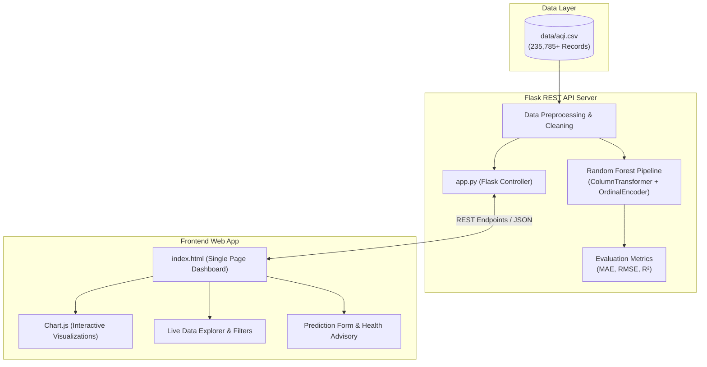

<div align="center">

# 🌿 AQI Insight Hub
### Intelligent Air Quality Analytics & Predictive Modeling Platform

[](https://python.org)
[](https://flask.palletsprojects.com/)
[](https://scikit-learn.org/)
[](https://pandas.pydata.org/)
[](https://www.chartjs.org/)

<br/>

<p align="center">
  <b>An end-to-end environmental intelligence hub that visualizes over 235,000+ national air quality records, analyzes pollutant concentrations, and delivers real-time machine learning predictions powered by Random Forest.</b>
</p>

[Explore Features](#-key-features) •
[Quick Start](#-quick-start) •
[Machine Learning](#-machine-learning-architecture) •
[API Reference](#-api-documentation) •
[Project Structure](#-project-structure)

<br/>

---

</div>

## 📌 Overview

**AQI Insight Hub** transforms extensive historical and real-time environmental data into actionable insights for citizens, researchers, and policymakers. 

Equipped with an interactive single-page dashboard, real-time analytics, dynamic charting, and a scikit-learn machine learning engine, users can evaluate ambient air quality trends across Indian states, inspect critical pollutants, and forecast Air Quality Index (AQI) values with health recommendations.

---

## ✨ Key Features

- **📊 Comprehensive Analytics Dashboard:** High-level KPI indicators displaying total analyzed observations, monitoring station density, pollutant distributions, and overall health indexes.
- **🤖 Machine Learning AQI Predictor:** Real-time inference powered by a trained **Random Forest Regressor** with automatic encoding and health impact analysis.
- **📈 Dynamic Interactive Visualizations:** Beautiful Chart.js graphs displaying state-wise averages, pollutant frequency, and AQI severity distributions.
- **🔎 Dataset Explorer with Live Filters:** Search, sort, and filter through 235,000+ environmental records with instant client-side pagination.
- **🩺 Tailored Health Advisory:** Automatic categorization into 6 CPCB standard brackets accompanied by medical and outdoor activity precautions.
- **⚡ High-Performance REST API:** Modular endpoints for raw data retrieval, explorer filters, model evaluation metrics, and prediction inference.
- **🎨 Glassmorphic Responsive Interface:** Modern, particle-animated dark/light responsive interface designed for desktop and mobile displays.

---

## 🚦 Central Pollution Control Board (CPCB) AQI Scale

The application classifies Air Quality Index according to standard national ambient benchmarks:

| AQI Range | Category | Color Indicator | Associated Health Advisory |
| :---: | :---: | :---: | :--- |
| **0 – 50** | **Good** | `🟢 #10b981` | Minimal impact; ideal for outdoor activities. |
| **51 – 100** | **Satisfactory** | `🟡 #84cc16` | Minor breathing discomfort to sensitive individuals. |
| **101 – 200** | **Moderate** | `🟠 #f59e0b` | Breathing discomfort to people with asthma and heart diseases. |
| **201 – 300** | **Poor** | `🔴 #f97316` | Breathing discomfort to most people on prolonged exposure. |
| **301 – 400** | **Very Poor** | `🟣 #ef4444` | Respiratory illness on prolonged exposure. Stay indoors. |
| **401+** | **Severe** | `🟤 #7f1d1d` | Healthy people affected; serious impacts on vulnerable groups. |

---

## 🏗️ Architecture & Tech Stack



---

## 🧠 Machine Learning Architecture

The predictive modeling module accurately forecasts numerical AQI levels given regional and station parameters:

- **Algorithm:** Random Forest Regressor (`n_estimators=80`, `max_depth=18`, `random_state=42`)
- **Features Analyzed:**
  - `state` *(Categorical: Ordinal Encoded)*
  - `area` *(Categorical: Ordinal Encoded)*
  - `prominent_pollutants` *(Categorical: Ordinal Encoded)*
  - `number_of_monitoring_stations` *(Numeric: Passthrough)*
- **Preprocessing Pipeline:** `ColumnTransformer` with `handle_unknown='use_encoded_value'` to gracefully handle unseen locations.
- **Model Evaluation Metrics:**
  - **Mean Absolute Error (MAE):** Quantifies average prediction discrepancy.
  - **Root Mean Squared Error (RMSE):** Penalizes larger forecasting errors.
  - **R-Squared ($R^2$) Score:** Explains variance percentage captured by the regressor.

---

## 📁 Project Structure

```text
AQI-INSIGHT-HUB/
│
├── analysis/
│   └── data_analysis.py         # Standalone exploratory data analysis script
│
├── data/
│   └── aqi.csv                  # 235,785+ historical AQI records
│
├── static/
│   ├── css/
│   │   └── style.css            # Custom responsive styles & modern themes
│   ├── js/
│   │   └── main.js              # Client-side logic, API connectors & Chart.js
│   └── images/
│       ├── aqi-bg.png           # Hero background visual
│       └── correlation_heatmap.png # Correlation visualization
│
├── templates/
│   └── index.html               # Main single-page web dashboard application
│
├── utils/
│   └── helpers.py               # Shared utility functions
│
├── app.py                       # Core Flask backend application & REST API
├── requirements.txt             # Python package dependencies
└── README.md                    # Project documentation
```

---

## 🚀 Quick Start

### 1. Prerequisites
- **Python 3.10+** installed on your system.
- Git (optional, for cloning).

### 2. Clone or Navigate to the Repository
```bash
cd AQI-INSIGHT-HUB
```

### 3. Create and Activate Virtual Environment
```bash
# Windows
python -m venv venv
.\venv\Scripts\activate

# macOS / Linux
python3 -m venv venv
source venv/bin/activate
```

### 4. Install Dependencies
```bash
pip install -r requirements.txt
```

### 5. Run the Application
```bash
python app.py
```

### 6. Open in Browser
Once running, navigate to:
```text
http://127.0.0.1:5000
```

---

## 📡 API Documentation

AQI Insight Hub provides clean REST endpoints delivering JSON payloads:

### Core Endpoints

| Method | Endpoint | Description |
| :---: | :--- | :--- |
| `GET` | `/` | Renders the primary dashboard user interface. |
| `GET` | `/api/status` | Returns backend server health, row count, and active columns. |
| `GET` | `/api/dashboard` | Returns summary statistics, top states, and pollutant metrics. |
| `GET` | `/api/data` | Paginated data records query with search & filter parameters. |
| `GET` | `/api/explorer-info` | Returns lists of available states, areas, and pollutants for dropdowns. |
| `GET` | `/api/quality` | Generates a data quality summary (missing values, data types). |
| `GET` | `/api/model` | Trains/fetches the Random Forest evaluation report (`MAE`, `RMSE`, `R²`). |
| `GET` | `/api/model-options`| Retrieves populated form options for model input fields. |
| `POST` | `/api/predict` | Executes prediction inference on user-supplied attributes. |

### Sample Prediction Request (`POST /api/predict`)

**Payload:**
```json
{
  "state": "Maharashtra",
  "area": "Amravati",
  "number_of_monitoring_stations": 2,
  "prominent_pollutants": "PM10"
}
```

**Response:**
```json
{
  "success": true,
  "predicted_aqi": 78.42,
  "category": "Satisfactory",
  "advice": "Air quality is acceptable. Sensitive people should take care.",
  "mae": 14.215,
  "rmse": 22.841,
  "r2": 0.842
}
```

---

## 🧪 Exploratory Data Analysis (EDA)

Run offline statistical exploration directly using the dedicated analysis script:

```bash
python analysis/data_analysis.py
```

This generates:
- Total dataset metrics, column structures, and null value counts.
- NumPy-calculated statistical dispersion ($\mu$, $\sigma$, median, min, max).
- Prominent pollutant counts and state-level record distributions.

---

## 🤝 Contributing

Contributions, issues, and feature suggestions are welcome!
1. Fork the Project.
2. Create your Feature Branch (`git checkout -b feature/AmazingFeature`).
3. Commit your Changes (`git commit -m "Add some AmazingFeature"`).
4. Push to the Branch (`git push origin feature/AmazingFeature`).
5. Open a Pull Request.


<div align="center">
  <br/>
  <sub>Built with 🌿 for cleaner, healthier, and smarter communities.</sub>
</div>
